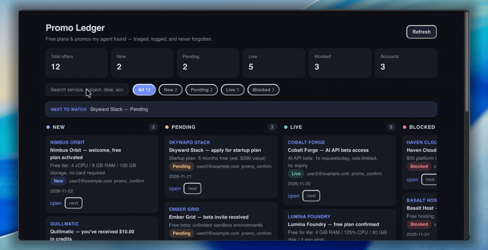

# Promo Agent — a personal agent that hunts free-tier offers

**A personal agent that watches your inbox, finds free plans and promos you're actually eligible for, logs them with proof, and triages each one — so you never pay for software you can get free.**

Built for [Fly.io Hacksgiving 2026](https://fly.io/hacksgiving): a personal agent that runs on a **Sprite** and uses **Sprites connectors**.

<p align="center">
  
  <br/>
  <em>Live demo (dummy data): search · filter · status cycle · drag-and-drop between kanban columns.</em>
</p>

---

## What it does

The agent turns a cluttered inbox into a searchable ledger of everything you can get for free:

- **Scans** your Gmail for promo / free-plan offers (signup confirmations, trial grants, expiry warnings, receipts).
- **Triages** each offer with an AI decision model — is it live? blocked? needs a card? expiring?
- **Logs** it with metadata: service, status, deal, expiry, account, source email.
- **Tracks** status over time and gives you a clean dashboard + API to act on each row.

It's the personal agent I wish I had: instead of me remembering "oh right, that $30 credit expires Friday," it watches and reminds me.

## How it works

```
Gmail ──► scanner ──► promo ledger (promos.json) ──► dashboard (index.html)
                    │                                  └─► REST API
                    └─► Levanto decision model (connector)
                            └─► OpenRouter LLM (fallback connector)
```

### The server

A **TurboAPI** app (FastAPI-compatible, **Zig HTTP core** — orders of magnitude faster than a plain Python server). It serves:

| Endpoint | Purpose |
|---|---|
| `GET  /api/promos` | list (filter: `status`, `account`, `kind`, `q`) |
| `GET  /api/promos/<id>` | one row |
| `GET  /api/stats` | counts by status / account / kind |
| `GET  /api/scan/status` | background rescan state |
| `POST /api/promos` | add a row (agent-friendly append) |
| `PATCH /api/promos/<id>` | update status / expiry / notes / deal |
| `DELETE /api/promos/<id>` | remove a row |
| `POST /api/scan` | trigger a background rescan |
| `POST /api/classify` | triage an offer via connectors |
| `POST /api/decide` | ask the decision model a yes/no question |
| `GET  /` | the dashboard |

### The connectors

The agent uses **Sprites connectors** so provider credentials live in your org, never in the code:

- **Levanto** (custom API connector) — a decision model that answers `choice`/`yesno` questions with calibrated probabilities. This is the primary triage engine.
- **OpenRouter** (BYOK connector) — LLM fallback for free-form summarization when the decision model abstains.

No keys in the repo. The gateway injects them.

## Quickstart

```bash
# needs free-threaded CPython 3.14t (TurboAPI requirement)
uv python install 3.14t
uv venv --python 3.14t .venv
uv pip install --python .venv/bin/python turboapi uvicorn

# first run seeds promos.json from promos.example.json
.venv/bin/python api.py --port 8734 --bind 127.0.0.1
# → dashboard at http://127.0.0.1:8734/
```

The dashboard is a **Foldkit** app (TypeScript/Effect). A built copy ships in `ui/dist/` (served automatically by `api.py`), so the quickstart needs no Node. To work on the UI:

```bash
cd ui
npm install
npm run dev      # vite dev server, proxies /api → 127.0.0.1:8734
npm run build    # rebuilds ui/dist/
```

That's it — the API and dashboard are live.

### Running on a Sprite

This is built to live on a [Fly.io Sprite](https://fly.io/sprites): a persistent Linux sandbox for agents.

```bash
sprite create --skip-console promo-agent
sprite file push -s promo-agent api.py index.html promos.example.json /home/sprite/
sprite exec -s promo-agent -- sprite-env services create web \
  --cmd /home/sprite/.venv/bin/python \
  --args api.py,--port,8080,--bind,0.0.0.0 \
  --http-port 8080
```

Then hit `https://<sprite>-<org>.sprites.app`. Requests to the `classify`/`decide` endpoints route through your Sprites connectors — set them up in the dashboard (**Connectors**) and point the env vars at your gateway URLs:

```bash
# set these to your own connector IDs (the repo ships placeholders)
LEVANTO_GATEWAY=https://api.sprites.dev/v1/gateway/custom_api/<connector_id>
OPENROUTER_GATEWAY=https://api.sprites.dev/v1/gateway/openrouter/<connector_id>/v1/chat/completions
```

## Repo layout

```
promo-agent/
├── api.py              # TurboAPI server (Zig core) + connector SDK
├── index.html          # legacy single-file dashboard (fallback)
├── promos.example.json  # sanitized sample ledger (seeds first run)
├── ui/                 # Foldkit dashboard (TypeScript/Effect, Elm architecture)
│   ├── src/            #   Model / Message / update / view
│   └── dist/           #   built assets (committed; served by api.py)
└── README.md
```

The live agent keeps real data in `promos.json` (git-ignored) — the repo ships only the sanitized sample.

## Project status

- **Server**: TurboAPI port complete; parity-verified against the original stdlib server (62 endpoint tests passed).
- **Connectors**: Levanto + OpenRouter wired and verified end-to-end on a Sprite.
- **Live demo**: running on a Sprite, token-gated (it holds personal data).
- **Scanner**: Gmail scanning (the `scan.py` module) exists in the author's environment; not included here as it requires personal OAuth credentials.

## Built with

- [TurboAPI](https://github.com/justrach/turboAPI) — FastAPI-compatible framework, Zig HTTP core
- [Foldkit](https://foldkit.dev) — TypeScript/Effect frontend framework (Elm architecture)
- [Fly.io Sprites](https://fly.io/sprites) — persistent Linux sandboxes for agents
- [Levanto](https://api.levanto.ai) — decision model via Sprites custom API connector
- [OpenRouter](https://openrouter.ai) — LLM fallback via Sprites connector

---

*Built during Fly.io Hacksgiving 2026. Prize or not, it now nags me about expiring credits.*
